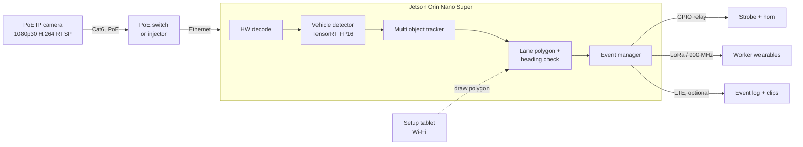
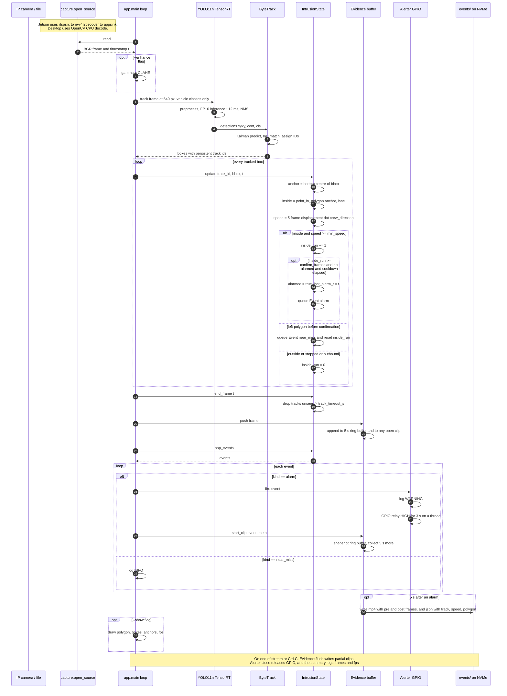

# Work Zone Lane Guard

**Design document · Draft 1**
Edge vision system on NVIDIA Jetson that detects vehicles entering a lane closed by a road crew and raises an alarm before they reach the workers.

| | |
|---|---|
| Author | EPLURIBUSUNUM |
| Date | 2026-00-00 |
| Status | Proposal |

## Contents

1. [Goals and non-goals](#1-goals-and-non-goals)
2. [Requirements](#2-requirements)
3. [System overview](#3-system-overview)
4. [Timing budget](#4-timing-budget)
5. [Compute hardware](#5-compute-hardware)
6. [Camera](#6-camera)
7. [Option A: DeepStream pipeline](#7-option-a-deepstream-pipeline)
8. [Option B: YOLO11n in plain Python](#8-option-b-yolo11n-in-plain-python)
9. [Comparison and recommendation](#9-comparison-and-recommendation)
10. [Intrusion logic](#10-intrusion-logic)
11. [Alerting and evidence](#11-alerting-and-evidence)
12. [Deployment and operations](#12-deployment-and-operations)
13. [Risks and mitigations](#13-risks-and-mitigations)
14. [Plan](#14-plan)

---

## 1. Goals and non-goals

A single camera looks upstream from the taper of a lane closure. A Jetson detects and tracks every vehicle, decides whether a track has entered the closed lane and is heading toward the crew, and triggers a local alarm with no dependence on network connectivity.

### Goals

- Warn the crew at least 3 seconds before an intruding vehicle reaches the first worker.
- Run fully offline on the Jetson. Cloud or LTE is optional for logging.
- Operate day and night, in rain, and with headlights pointed at the camera.
- Fewer than one false alarm per hour of normal traffic.
- Set up by a crew member in under 10 minutes with a tablet.

### Non-goals for v1

- License plate capture or enforcement.
- Multi-camera fusion across the full closure length.
- Radar fusion. Kept as an upgrade path, see Risks.
- Pedestrian or worker tracking.

## 2. Requirements

| ID | Requirement | Target |
|----|-------------|--------|
| R1 | Detection range for a passenger car | ≥ 400 ft from camera |
| R2 | End to end latency, photons to alarm output | ≤ 500 ms |
| R3 | Inference frame rate per camera | ≥ 30 fps |
| R4 | Camera to Jetson cable run | 25 ft, up to 300 ft |
| R5 | Operating temperature | -20 °C to 55 °C |
| R6 | Power draw of compute unit | ≤ 25 W |
| R7 | Event evidence | 10 s clip, track, timestamp, speed estimate |
| R8 | False alarm rate | < 1 per hour |

## 3. System overview

The same hardware supports both software options. Only the vision pipeline changes between Option A and Option B.



## 4. Timing budget

Latency drives everything else. A vehicle at highway speed covers a lot of road while the pipeline is thinking, so the camera must look far upstream and the pipeline must stay well under half a second.

| Speed | Distance per second | Distance per 500 ms | Distance in 3 s warning |
|-------|--------------------:|--------------------:|------------------------:|
| 35 mph | 51 ft | 26 ft | 154 ft |
| 55 mph | 81 ft | 40 ft | 242 ft |
| 70 mph | 103 ft | 51 ft | 308 ft |

| Stage | Typical | Notes |
|-------|--------:|-------|
| Camera exposure + encode | 60 to 120 ms | Set GOP short, disable smart codec buffering |
| Network + RTSP jitter buffer | 20 to 80 ms | Use `latency=0` on rtspsrc, UDP where possible |
| Decode | 5 to 15 ms | NVDEC in both options |
| Inference | 5 to 12 ms | YOLO11n or TrafficCamNet at 640 px, FP16 |
| Tracker + ROI logic | 2 to 5 ms | |
| Confirmation window | 100 to 170 ms | 3 to 5 consecutive frames inside polygon |
| GPIO + strobe | 10 to 30 ms | Relay coil pull in time dominates |
| **Total** | **200 to 430 ms** | Within R2 with margin |

> **Placement rule.** At 55 mph with a 3 second warning plus 0.5 second pipeline latency, the polygon entry line must sit at least 285 ft upstream of the first worker. The camera therefore needs a lens that renders a car at 300 to 400 ft as at least 24 px wide. See the lens table in section 6.

## 5. Compute hardware

### Why an edge GPU, and why Jetson

The YOLO model itself runs anywhere. Jetson answers a different question: what is the cheapest box that runs YOLO at 30 fps on a 1080p stream, in real time, on battery, in a roadside enclosure, with no network.

The work zone box has to decode a 1080p30 stream, run a detector on every frame, respond in under half a second, draw under 25 W from a truck battery, survive heat and vibration, and keep working with the network down. Cloud inference adds 200 to 500 ms of round trip latency plus a hard dependency on LTE coverage, which rules it out for the alarm path.

| Platform | YOLO11n 1080p fps | Power | Rough cost | Verdict |
|----------|------------------:|------:|-----------:|---------|
| Raspberry Pi 5, CPU only | 2 to 4 | 8 W | $80 | Too slow. A car at 55 mph moves 40 ft between frames. |
| Pi 5 + Hailo-8L AI HAT | 25 to 40 | 12 W | $150 | Workable for one camera. Weaker tooling, no hardware video decode, int8 only. |
| Intel N100 mini PC, OpenVINO | 15 to 25 | 15 to 25 W | $180 | Borderline. Decent for one camera at reduced resolution. |
| Google Coral USB | 20 to 30 | 10 W | $140 | Int8 only, tiny on-chip memory, product line largely abandoned. |
| **Jetson Orin Nano Super** | 90+ | 7 to 25 W | $249 | Headroom for two cameras, a tracker, and recording. Hardware decode and encode on chip. |
| Laptop with RTX GPU | 200+ | 60 to 150 W | $1,500 | Fine for the bench. Wrong power and form factor for the road. |
| Cloud GPU | Unlimited | Remote | Per hour | Latency and connectivity make it unsafe for a real time alarm. Fine for training and offline analytics. |

Jetson wins on four points:

- It is the only option with a real GPU, hardware video decode, hardware encode for evidence clips, and a full CUDA stack in one low power module.
- TensorRT turns YOLO11n into a 5 to 12 ms per frame engine. That headroom is what allows multi frame confirmation while still beating the latency budget.
- The same code and model run on an RTX laptop during development and on the Jetson in the field with no changes.
- Rugged industrial carriers exist off the shelf, which is not true for most of the alternatives.

When Jetson would not be needed: offline review of recorded video can run on a laptop or in the cloud; a single camera that only needs to detect at the taper rather than 400 ft out could use a Pi 5 with a Hailo accelerator at the cost of warning time; and if a radar unit does primary detection with the camera only for evidence, almost no compute is required.

### Jetson module

| Module | AI perf | Memory | Power | Dev kit price | Fit |
|--------|--------:|-------:|------:|--------------:|-----|
| **Jetson Orin Nano Super 8GB** (pick) | 67 TOPS | 8 GB | 7 to 25 W | $249 | 1 to 2 cameras at 1080p30 with a nano class model. Meets R6. |
| Jetson Orin NX 16GB | 157 TOPS | 16 GB | 10 to 40 W | ~$700 w/ carrier | 4+ cameras, or thermal + visible fusion, or a medium model. |
| Jetson AGX Orin 64GB | 275 TOPS | 64 GB | 15 to 60 W | $1,999 | Overkill for this. Only for a full closure with 8 cameras. |

Software baseline is JetPack 6.2 with CUDA 12.6, TensorRT 10, and DeepStream 7.1. Both options build on the same image so the hardware decision is independent of the software decision.

### Carrier and enclosure

- **Development:** Orin Nano Super developer kit as is.
- **Field units:** an industrial carrier with wide input DC, such as Seeed reComputer Industrial J3011 or Advantech MIC-711. Both are fanless, rated to 60 °C, and take 9 to 36 V so they run from a truck battery or an arrow board power bus.
- IP65 enclosure with a vented, heated compartment if units deploy below -10 °C. Passive heatsink is enough at 15 W.
- 256 GB NVMe for a rolling 72 hour video buffer and event clips.

### Network and power

- Single port 802.3af PoE injector or a 4 port PoE switch such as a Netgear GS305P, powered from the same 12 V bus through a DC to DC converter.
- Outdoor rated shielded Cat6, IP67 RJ45 coupler at the camera for quick disconnect, drip loop at both ends.
- Total system draw is roughly 15 W Jetson plus 8 W camera plus 3 W switch, about 26 W. A 100 Ah 12 V LiFePO4 battery runs a 10 hour shift with large margin.

### Alert outputs

- 4 channel opto isolated relay HAT on the Jetson 40 pin header. Drives a 12 V LED strobe and a 110 dB horn directly.
- LoRa or 900 MHz transceiver on USB for wearable vibration alarms. Latency under 100 ms, range over 1,000 ft.
- Optional LTE modem over USB for event upload and remote health checks.

## 6. Camera

The 25 ft run from camera to Jetson rules out CSI ribbon cameras and makes USB marginal. A PoE IP camera is the right choice: one cable for power and data, 300 ft reach, weatherproof connectors, and swappable without touching the compute box.

### Required specifications

| Attribute | Requirement | Why |
|-----------|-------------|-----|
| Form factor | Fixed bullet, IP66 or IP67, IK10 | Sun shield, easy to aim down the road, survives debris |
| Resolution and rate | 1920×1080 at 30 fps | Enough pixels at 640 px inference. 4K slows decode with no detection gain |
| Sensor | 1/1.8 inch or larger, starlight class | Night work with low ambient light |
| Dynamic range | True WDR, 120 dB or better | Headlights pointed at the lens |
| Shutter | Manual cap at 1/500 s or faster | Prevents motion blur on cars at 70 mph |
| Lens | Motorized varifocal 2.8 to 12 mm, or fixed 6 to 8 mm | Tune field of view to the taper length on site |
| Streaming | RTSP, H.264 and H.265, configurable GOP, ONVIF Profile S | Works with both pipelines, no vendor lock in |
| IR | Built in IR illuminator, 150 ft or more | Fallback when no street lighting exists |
| Power | 802.3af PoE, under 13 W including IR and heater | Single cable, fits battery budget |
| Environmental | -30 °C to 60 °C | Matches R5 with margin |

### Lens choice versus detection distance

Horizontal field of view and the pixel width of a 6 ft wide car on a 1/1.8 inch sensor at 1080p. The detector needs about 24 px to be reliable.

| Focal length | Horizontal FOV | Car width at 200 ft | Car width at 300 ft | Car width at 400 ft |
|-------------:|---------------:|--------------------:|--------------------:|--------------------:|
| 2.8 mm | ~105° | 14 px | 9 px | 7 px |
| 6 mm | ~55° | 33 px | 22 px | 17 px |
| **8 mm** (pick) | ~42° | 45 px | 30 px | 22 px |
| 12 mm | ~29° | 68 px | 45 px | 34 px |

A varifocal set near 8 mm gives detection out to roughly 400 ft while still seeing both lanes at the taper. Go to 12 mm on long straight highway closures where the camera can be aimed down a single approach.

### Candidate cameras

| Model | Sensor | Lens | Notes |
|-------|--------|------|-------|
| Axis P1465-LE | 1/1.8 in, 2 MP | 3 to 9 mm varifocal | Lightfinder 2.0 and Forensic WDR. Low latency Zipstream can be disabled. NDAA compliant. Premium price. |
| **Hanwha XNO-6085R** (pick) | 1/1.8 in, 2 MP | 4.1 to 16.4 mm motorized | Good night performance, strong WDR, 1/12000 s shutter. NDAA compliant. Mid price. |
| Bosch DINION 5100i IR | 1/2.8 in, 2 MP | 3.2 to 10.5 mm | Reliable firmware, slightly smaller sensor. NDAA compliant. |
| Dahua or Hikvision 2 MP starlight bullet | 1/1.8 in | 2.7 to 13.5 mm | Cheapest and performs well. Restricted under NDAA Section 889, so not usable on federally funded DOT work. |

### Alternatives considered

- **GMSL2 camera over coax** such as Leopard Imaging or e-con Systems modules. Sub 50 ms glass to pixel latency and global shutter, but requires a deserializer carrier and raises cost by several hundred dollars. Revisit only if IP camera latency proves to be the bottleneck.
- **Thermal camera** such as Axis Q1951-E or FLIR FC-Series. Makes night detection trivial and ignores headlight glare, but costs 3 to 6 times more and needs the detector fine tuned on thermal data. Recommended as a v2 second sensor rather than a replacement.
- **USB 3 camera with active cable.** Rejected. Active USB cables are unreliable under vibration and heat.

## 7. Option A: DeepStream pipeline

DeepStream is NVIDIA's GStreamer based video analytics SDK. It provides hardware decode, batched TensorRT inference, a multi object tracker, and a region of interest analytics plugin as drop in elements. Most of this design is configuration rather than code.

```
rtspsrc latency=0 → rtph264depay → nvv4l2decoder → nvstreammux
  → nvinfer (TrafficCamNet or YOLO11n engine, FP16, batch 1)
  → nvtracker (NvDCF, config tracker_NvDCF_perf.yml)
  → nvdsanalytics (lane polygon ROI, direction filter)
  → probe callback: read NvDsAnalyticsObjInfo, run confirmation state machine, fire alert
  → nvdsosd → nvv4l2h264enc → filesink (rolling evidence buffer)
```

### Model

Start with **TrafficCamNet** from NGC. It is a ResNet18 DetectNet_v2 detector trained on roadside views of cars, trucks, two wheelers and road signs, and ships as a pruned INT8 model that nvinfer loads directly. If recall on distant vehicles is insufficient, swap in a YOLO11n engine using the community DeepStream-Yolo parser. The rest of the pipeline is unchanged.

### Lane polygon and direction

The nvdsanalytics configuration takes the polygon in image coordinates and a direction vector. Vehicles are reported as inside the ROI with a direction match, so the probe only needs to count consecutive frames and debounce.

```ini
[roi-filtering-stream-0]
enable=1
roi-ClosedLane=412;1080;690;1080;980;612;940;598
inverse-roi=0
class-id=0;1;2

[direction-detection-stream-0]
enable=1
direction-Inbound=960;400;700;1000
class-id=0;1;2
```

### Pros

- Zero copy from decoder to inference. Lowest CPU use, most headroom for a second camera.
- Tracker and ROI analytics already written and tested.
- Scales to 4 or more cameras by adding sources to nvstreammux.
- TrafficCamNet is purpose trained on traffic camera views.

### Cons

- GStreamer debugging is unfriendly. Pipeline stalls show up as silence.
- Version coupling between JetPack, DeepStream and TensorRT. Upgrades are all or nothing.
- Custom logic lives in probe callbacks, which are awkward to unit test.
- Steeper learning curve for contributors who have not used it.

## 8. Option B: YOLO11n in plain Python

A conventional Python application. OpenCV pulls frames, a TensorRT engine exported from Ultralytics YOLO11n detects vehicles, ByteTrack assigns IDs, and Shapely tests each track against the lane polygon. Every stage is ordinary Python that can be run and tested on a laptop with a video file.

```python
cap = cv2.VideoCapture(
  "rtspsrc location=rtsp://cam/stream latency=0 ! rtph264depay ! h264parse "
  "! nvv4l2decoder ! nvvidconv ! video/x-raw,format=BGRx ! videoconvert "
  "! video/x-raw,format=BGR ! appsink drop=true max-buffers=1", cv2.CAP_GSTREAMER)

model = YOLO("yolo11n.engine")                 # exported with model.export(format="engine", half=True)
lane  = Polygon(load_polygon("lane.json"))
state = IntrusionState(confirm_frames=4, cooldown_s=8)

while True:
    ok, frame = cap.read()
    res = model.track(frame, persist=True, tracker="bytetrack.yaml",
                      classes=[2, 3, 5, 7], imgsz=640, verbose=False)[0]
    for box, tid in zip(res.boxes.xyxy, res.boxes.id):
        foot = Point((box[0] + box[2]) / 2, box[3])  # bottom centre
        state.update(int(tid), lane.contains(foot), heading(tid, foot))
    for event in state.pop_alarms():
        alerts.fire(event); evidence.save_clip(event)
```

Using a GStreamer capture string keeps decode on NVDEC even without DeepStream. The only CPU cost is the colour conversion and one memory copy per frame, which is fine for one 1080p stream on Orin Nano.

### Model

**YOLO11n** pretrained on COCO already covers car, motorcycle, bus and truck. Export once on the Jetson with FP16 and 640 px input. Expected throughput on Orin Nano Super is about 90 fps for inference alone. A later fine tune on 1,000 to 2,000 frames from real work zones will improve recall on small distant vehicles and on construction equipment that COCO never saw.

### Pros

- Readable, testable Python. Intrusion logic is a pure function with unit tests.
- Runs on a developer laptop against recorded video with no Jetson.
- Easy to swap models, trackers, or add a radar input.
- Ultralytics handles export, tracking and ONNX quirks.

### Cons

- One CPU copy per frame. Fine for 1 to 2 cameras, tight beyond that.
- Python GIL means a second camera should be a second process.
- Ultralytics is AGPL licensed. A commercial product needs their enterprise license or a swap to a permissively licensed YOLO.
- You own the evidence recorder and the health monitoring.

## 9. Comparison and recommendation

| Criterion | A: DeepStream | B: YOLO11n Python |
|-----------|---------------|-------------------|
| Time to first working demo | 2 to 3 weeks | 3 to 5 days |
| Latency, decode to alert | 15 to 25 ms | 25 to 40 ms |
| CPU load, 1 camera | ~10% | ~35% |
| Cameras per Orin Nano | 4 | 2 |
| Testability on laptop | Needs NVIDIA GPU + container | Any machine, CPU ok |
| Ease of adding radar fusion | Custom plugin or probe | Plain Python |
| Licensing for commercial use | Free with NVIDIA hardware | AGPL unless licensed |
| Operational maturity | Production grade | You build it |

> **Recommendation.** Build the prototype and field trials on Option B. It gets a camera on a tripod and an alarm firing within a week, and the intrusion logic, polygon tool, evidence recorder and alert outputs all carry over. Move the inference pipeline to Option A when either of two things happens: a third camera is needed per box, or the product goes commercial and AGPL becomes a problem. Design the code so the detector and tracker sit behind one interface that yields `(track_id, class, bbox)` tuples, which is all the intrusion logic consumes.

## 10. Intrusion logic

Identical in both options. The detector and tracker produce a stream of tracked boxes; this layer decides when to alarm.

1. **Anchor point.** Use the bottom centre of the bounding box as the vehicle's position on the road surface. It is far less sensitive to vehicle height than the box centre.
2. **Containment.** Test the anchor against the closed lane polygon drawn at setup.
3. **Heading.** Compute displacement over the last 5 frames. Require a component toward the crew greater than a threshold, which rejects vehicles backing out or stopped at the taper.
4. **Confirmation.** Alarm only after 4 consecutive frames inside with inbound heading. At 30 fps that is 133 ms and removes single frame tracker jitter.
5. **Exit grace.** A track that leaves the polygon within the confirmation window is a late merge, not an intrusion. Log it as a near miss.
6. **Cooldown.** One alarm per track, and a global 8 second cooldown so a platoon does not produce a continuous horn.
7. **Speed estimate.** Use a 4 point homography from the polygon corners to road coordinates to convert pixel displacement into mph for the event log. Accuracy of ±10% is adequate for evidence.

### Implementation sequence

Per frame flow through the `laneguard` package, as implemented in Option B. The DeepStream variant replaces the capture, detector and tracker participants with GStreamer elements; the IntrusionState, Evidence and Alerter steps are identical.



Timing on the T400 development box: capture plus decode 2 to 15 ms depending on resolution, inference 12 ms, tracker and intrusion logic under 2 ms, evidence push under 1 ms. The alarm decision is made on the frame that completes the confirmation run, so the decision latency after a vehicle enters the lane is `confirm_frames / fps`, 133 ms at 30 fps with four frames.

### Setup flow

A crew member connects a tablet to the Jetson's Wi-Fi hotspot, sees the live camera frame, taps the four corners of the closed lane, taps the direction of the crew, and saves. The polygon is stored as image coordinates with a snapshot of the frame so a shifted camera can be detected later by comparing frames.

## 11. Alerting and evidence

**Warn locally and record the event.** Connect the Jetson to an alarm controller for a siren, strobe, and potentially vibrating wearables. Keep the warning path operational without internet access; use connectivity only for event review and remote monitoring. The FHWA assessment of work zone intrusion alert technologies discusses audible, visual, and haptic alerts and found that crews respond fastest to a combination of all three, which is why the tiers below use a horn, a strobe, and wearables together.

- **Tier 1, local:** relay closes strobe and horn within 30 ms of the decision. No software between the decision and the relay beyond a GPIO write.
- **Tier 2, wearables:** LoRa broadcast to vibrating armbands. Separate radio so a Wi-Fi outage does not matter.
- **Tier 3, record:** write a 10 second clip, 5 seconds before and 5 after, from the rolling buffer. Store JSON with track path, speed, polygon, and timestamps. Upload over LTE when available.
- **Closure metadata:** at setup the operator links the deployment to its Caltrans Lane Closure System record from the web interface, by district, text search, or nearest active closures. The closure index, ID and log number, route, postmile range, direction, type of work, type of closure and lanes closed are stamped into every event JSON, along with crew, operator and notes. Events then join directly to Caltrans records without manual matching. See the LCS field reference at cwwp2.dot.ca.gov/documentation/lcs.
- **Health:** heartbeat every 5 seconds to a watchdog. Loss of frames for 2 seconds, camera disconnect, or a frozen image triggers a distinct fault tone so the crew knows the system is blind rather than quiet.

## 12. Deployment and operations

- Jetson boots to a systemd service that starts the pipeline. No login required.
- Application ships as a container on the JetPack base image so a field unit updates by pulling one image.
- Camera mounts on a 12 ft mast on the attenuator truck or on the first arrow board trailer. A rigid mount matters more than height. Vibration moves the polygon.
- Daily start of shift check: open the tablet view, confirm the polygon overlays the lane, drive a pickup through the closed lane at low speed and confirm the alarm fires.

## 13. Risks and mitigations

| Risk | Severity | Mitigation |
|------|----------|------------|
| Headlight glare at night washes out detections | High | Large sensor with true WDR, fixed short exposure, camera mounted high and angled down. Thermal second camera in v2. Confirmed 2026-10-10: pretrained YOLO11 n, s and m all missed headlight-facing cars on an unlit night clip, and CLAHE enhancement made it worse. Fine tuning on night footage is now on the critical path; see results.md. |
| Camera shake invalidates polygon | High | Rigid mount, frame diff against setup snapshot, auto fault if the scene shifts more than 20 px. |
| Distant cars too small for detector | Medium | 8 mm or longer lens, 640 px or larger inference, fine tune on work zone data. |
| False alarms from legitimate late merges | Medium | Heading check, exit grace window, placement of entry line at the taper not before it. |
| Rain, fog, snow on lens | Medium | Sun shield and hydrophobic coating. Radar fusion is the real fix and is the top v2 item. |
| IP camera latency exceeds budget | Medium | Measure with a flashing LED in frame. Fall back to GMSL camera if over 150 ms. |
| Thermal throttling in summer | Low | Fanless industrial carrier rated to 60 °C, 15 W power mode. |

## 14. Plan

1. **Week 1.** Order Orin Nano Super dev kit, Hanwha camera, PoE injector, relay HAT. Record 2 hours of work zone video from a safe spot for offline development.
2. **Week 2.** Option B running on a laptop against recorded video. Polygon tool, intrusion state machine with unit tests, event JSON.
3. **Week 3.** Move to Jetson. Export TensorRT engine, measure fps and latency with the LED method, wire relay and strobe.
4. **Week 4.** Controlled test on a closed lot with a vehicle driving into the polygon at 20, 40 and 55 mph. Tune confirmation frames and heading threshold.
5. **Weeks 5 to 8.** Shadow mode on a real closure with alarms muted. Collect false alarm and miss statistics against a human log. Fine tune the model on collected frames.
6. **Decision point.** Review false alarm rate against R8. Decide whether to port to DeepStream based on camera count and licensing needs.

---

*Prices and model numbers are current as of October 2026 and should be reverified at purchase. Pixel width figures assume a 1/1.8 inch sensor at 1920 px horizontal and a 6 ft wide car.*
